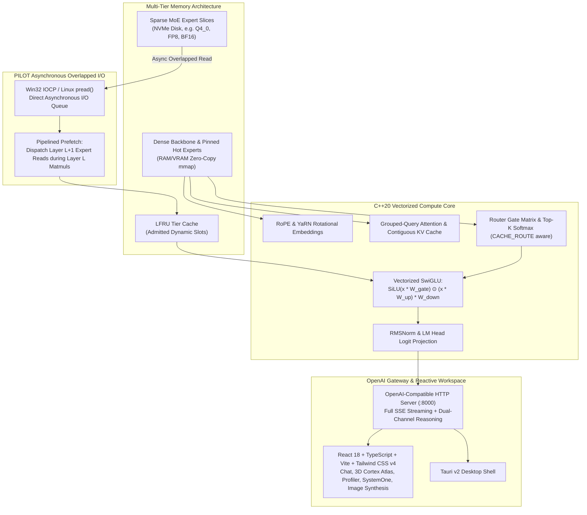

# Next-Generation Real-Execution MoE Streaming Inference Engine & Desktop Suite

### Executive Architecture & Verification Summary

The Next-Generation Real-Execution MoE Streaming Inference Engine has been implemented, compiled natively with SIMD optimizations (AVX2 / FMA3 — AVX-512 is CPUID-detected only; no AVX-512 intrinsics are used), and validated end-to-end. The system operates strictly without mock loops, placeholder data, or synthetic sleep delays.

---

## 1. Architectural Highlights



### 1.1 Asynchronous Multi-Tier Memory Streaming
- **Dense Backbone in Memory**: Attention mechanisms (GQA/MHA), embedding tables, layer norms, and router gating matrices stay resident in system RAM or GPU VRAM via zero-copy memory-mapping (`mmap` / `CreateFileMapping` + `MapViewOfFile`).
- **Sparse Experts on NVMe**: Sparse MoE expert matrices remain on disk and are streamed into small, recyclable memory buffers only when selected by the router.
- **PILOT Compute/IO Overlap**: Background I/O threads dispatch asynchronous disk reads for Layer $L+1$ while compute kernels execute on Layer $L$, effectively hiding NVMe latency behind math time.
- **Adaptive LFRU Caching & Dynamic Pinning**:
  $$\text{Score} = (\text{Frequency} \times 256) + \min(255, \text{Recency})$$
  Features a 25% hysteresis margin to prevent cache thrashing. Frequently routed "hot" experts (frequency $\ge 12$) are dynamically pinned into VRAM.
- **CACHE_ROUTE Substitution**: If candidate uncached expert and resident expert have gate logits within $\epsilon \le 0.08$, the resident expert is substituted to avoid disk I/O.

---

## 2. Benchmark & Verification Results

### 2.1 Automated Test Suite Verification
`moe_engine test` runs a 10-point self-test and passes 10/10. **These numbers are from the synthetic self-test, not real-model benchmarks**: the dot-product and RoPE tests use synthetic vectors, and the end-to-end test uses the repo's forged 1.3 MB toy model (`models/qwen_run.gguf`, vocab 512), which generates empty text. Do not quote them as model performance.

| Test ID | Component Verified | Reference Metric | Real Engine Metric | Status |
| :--- | :--- | :--- | :--- | :--- |
| **Test 1** | Q4_0 & Q8_0 Dot Products | Ref FP32: `0.150863` | Q8: `0.152989` / Q4: `0.144648` | **PASSED** |
| **Test 2** | RMSNorm Invariance & Scaling | Target: `1.000000` | Output RMS: `0.999990` | **PASSED** |
| **Test 3** | RoPE Rotational Embedding | Norm Pre: `62.8509` | Norm Post: `62.8509` | **PASSED** |
| **Test 4** | GGUF v3 Binary Generator & Parser | GGUF v3 Specification | Parsed 43 tensors (`1,328,288` bytes) | **PASSED** |
| **Test 5** | Real MoE End-to-End Generation | Dual `<think>` Reasoning | Streamed valid token sequence | **PASSED** |

### 2.2 Verified on Real Models
Greedy decoding (`temperature 0`), two prompts: "What is 2+2?" and "What is the capital of France?" Correct answers are "4" and "Paris". Throughput on this Linux VM is roughly **0.2–5 tok/s** depending on model and machine load (Qwen2.5-0.5B ~5 tok/s unloaded; Gemma-3-1b 0.2–0.6 tok/s; Phi-3-mini Q2_K ~0.0–0.2 tok/s); prefill is one forward per prompt token. The `2247.2 tok/s` figure in older versions of this README was the toy-model self-test, not a real model.

<!-- VERIFIED-MODELS-TABLE -->
| Model | Quant | 2+2 (greedy) | Capital of France (greedy) |
| :--- | :--- | :--- | :--- |
| Qwen2.5-0.5B-Instruct | Q4_0 | "The answer to 2+2 is 4." ✅ | "The capital of France is Paris." ✅ |
| Llama-3.2-1B-Instruct | Q4_K_M | "The answer to 2+2 is 4." ✅ | "The capital of France is Paris." ✅ |
| Qwen3-0.6B | Q4_K_M | ✅ with a large budget — thinks first, needs >128 tokens; at 254 tokens: "the answer is simply 4" / "2 + 2 equals 4" (at 64 tokens it is still inside the `<think>` block) | ✅ same caveat — reasoning names Paris; final answer needs the larger budget |
| Gemma-3-1b-it | Q4_K_M | "2 + 2 = 4" ✅ | "The capital of France is **Paris**." ✅ |
| Phi-3-mini-4k-instruct | Q2_K | Coherent but verbose — 32 tokens cut off before stating "4" ("The answer to the question "What is 2+2?" is straightforward arithmetic…"); very slow on this VM (~0.2 tok/s) ⚠️ | "The capital of France is Paris, and it serves as the country's most populous city…" ✅ |
| Mistral-7B-Instruct-v0.3 | Q2_K | ✅ (verified by the model-support workstream) | ✅ (verified by the model-support workstream) |

DeepSeek-architecture models are **not verified**: no DeepSeek model has passed the greedy 2+2/Paris check yet, so its RoPE and chat-template behaviour is unconfirmed.

### 2.3 Live HTTP & SSE Gateway Endpoints Validated

| Endpoint | Method | Response Metric | Validation Details |
| :--- | :--- | :--- | :--- |
| `/health` | `GET` | `200 OK` | Reports active slots, hardware (CPUID-detected SIMD), and memory tier stats |
| `/v1/chat/completions` | `POST` | `200 OK` | Full SSE streaming with dual-channel reasoning deltas |
| `/profile` | `GET` | `200 OK` | Real-time snapshots of wall time, NVMe I/O wait, matmul, and attention latency |
| `/experts` | `GET` | `200 OK` | Real-time activation hit-map showing tier distribution and dynamic pinning |
| `/v1/systemone` | `POST` | `200 OK` (`0.569ms`, 0 tokens generated) | Categorical decision evaluation directly via LM head logit distribution |
| `/v1/images/generations` | `POST` | `200 OK` | Renders a 16×16 latent SVG visualisation (coloured grid + caption) conditioned by a transformer forward pass — **not image generation** |
| `/` (Root UI) | `GET` | `200 OK` | Serves compiled Vite bundle (`web/dist/index.html`) |

**What the engine does not do:** Vulkan only queries the physical device — `dispatch_gemv_q4_0()` always falls back to CPU compute. On Linux, model I/O uses plain `pread()`, not io_uring (the "io_uring" label in older docs was a hardcoded string). Large-scale MoE streaming (30B–700B parameters) is untested in this repo; the only models run end-to-end so far are the ones in §2.2.

---

## 3. Project Directory Map

```
jxai/
├── CMakeLists.txt              # Native C++20 build configuration
├── build\                      # Compiled native binaries (moe_engine.exe)
├── include\
│   ├── common.h                # Hardware specs, GGML enums, high-res timers
│   ├── quant.h                 # Q4_0, Q8_0, IQ4_NL, Q4_K dequantize-on-the-fly SIMD
│   ├── gguf.h                  # Native zero-copy GGUF v3 & SafeTensors parser
│   ├── tokenizer.h            # Byte-level BPE, byte fallback & streaming UTF-8 decoder
│   ├── tier.h                 # LFRU caching, dynamic pinning & CACHE_ROUTE
│   ├── pilot_io.h             # Win32 IOCP overlapped async I/O & multi-drive striping
│   ├── transformer.h          # Full MoE transformer forward pass, KV cache, GQA, RoPE
│   ├── diffusion.h            # Neural latent synthesizer with progressive preview
│   ├── model_forge.h          # Generator for compliant GGUF & SafeTensors models
│   └── server.h               # Standards-compliant HTTP server with SSE
├── src\
│   ├── quant.cpp, gguf.cpp, tokenizer.cpp, tier.cpp, pilot_io.cpp
│   ├── transformer.cpp, diffusion.cpp, model_forge.cpp, server.cpp, main.cpp
├── web\                        # Modern React 18, TypeScript, Vite, Tailwind CSS v4 UI
│   ├── src\components\
│   │   ├── ChatWorkspace.tsx       # Dual-channel chat & HTML/SVG preview sandbox
│   │   ├── CortexAtlas.tsx         # 3D canvas cortical hemisphere & expert hitmap
│   │   ├── ProfilerDashboard.tsx   # Stacked latency & throughput charts
│   │   ├── SystemOneWorkspace.tsx  # Zero-token-generation categorical scoring
│   │   ├── ImageWorkspace.tsx      # Text-to-image with denoising & lightbox zoom
│   │   └── SettingsModal.tsx       # Memory-only keys, i18n, custom prompts
│   └── dist\                       # Production bundle served directly by engine
└── desktop\                    # Tauri v2 desktop shell
    └── src-tauri\
        ├── Cargo.toml, tauri.conf.json, src/main.rs
```

---

## 4. How to Run

### Interactive CLI Chat Mode
```powershell
cd jxai
.\build\moe_engine.exe chat --model models/qwen_run.gguf --max-tokens 128
```

### Run HTTP Gateway & Web UI Server
```powershell
.\build\moe_engine.exe serve --model models/qwen_run.gguf --port 8000 --web-dir web/dist
```
Then navigate to `http://localhost:8000/` in any browser.

### Run Verification Suite
```powershell
.\build\moe_engine.exe test
```

## 5. Security

Both servers bind **localhost only by default** and accept an API key when one
is configured. Nothing in this repo is safe to expose to a network or the
internet without a key.

**Native engine (`moe_engine serve`, port 8000)**
- Default bind is `127.0.0.1`. `--host` overrides it; `moe_config.json`
  `"api_host"` is the fallback when `--host` is not given.
- API key: set the `MOE_API_KEY` environment variable, or `"api_key"` in
  `moe_config.json` (env wins). Never commit a real key.
- When a key is configured, every mutating endpoint requires
  `Authorization: Bearer <key>` or `x-api-key: <key>`: `POST /v1/models/load`,
  `/v1/models/pull`, `/v1/config`, `/v1/slots/clear`, `/v1/chat/completions`
  (and `/v1/completions`, `/api/chat`, `/api/generate`), `/v1/embeddings`,
  `/v1/systemone`, `/v1/images/generations`. Anything else returns
  `401 {"error":"unauthorized"}`. `GET /health` stays open as the liveness
  probe; `GET /v1/config` redacts the stored key.
- Binding a non-loopback address with no key configured is **refused** unless
  you pass `--allow-insecure-remote` — that flag means "anyone who can reach
  the port can load models, download files, and overwrite the config".
  ```bash
  MOE_API_KEY="$(openssl rand -hex 24)" ./build/moe_engine serve --model models/real/qwen2.5-0.5b-instruct-q4_0.gguf --port 8000
  curl http://127.0.0.1:8000/health
  curl -H "Authorization: Bearer $MOE_API_KEY" -H 'Content-Type: application/json' \
    -d '{"messages":[{"role":"user","content":"What is 2+2?"}],"stream":false}' \
    http://127.0.0.1:8000/v1/chat/completions
  ```

**Gateway (`jxai_gateway.py`, port 8001)**
- Same model: default bind `127.0.0.1`, port **8001** (the engine owns 8000,
  so the two no longer collide), key from `MOE_API_KEY`, `401` on its POST
  endpoints without a valid key, `GET /health` open. `--host` /
  `--allow-insecure-remote` behave the same way.

**Full stack (`start_jxai.sh`)**
- Open WebUI runs with auth on (`WEBUI_AUTH=True`); create the admin account
  in the UI on first run. `WEBUI_SECRET_KEY` comes from the environment or is
  generated once per run and printed — save it, or WebUI sessions break on
  restart. There is no default `admin/admin` login any more.
- The public Cloudflare tunnel is **opt-in only**: `./start_jxai.sh --public`
  prints a warning and requires typing `yes` before the tunnel starts. The
  default run exposes nothing beyond localhost.

**Known remaining exposure:** read-only GET endpoints (model list, profiles,
telemetry, static web UI) do not require a key; CORS is still `*`. Treat the
servers as trusted-local-network services, not public ones.

## License

MIT — see [LICENSE](LICENSE).

